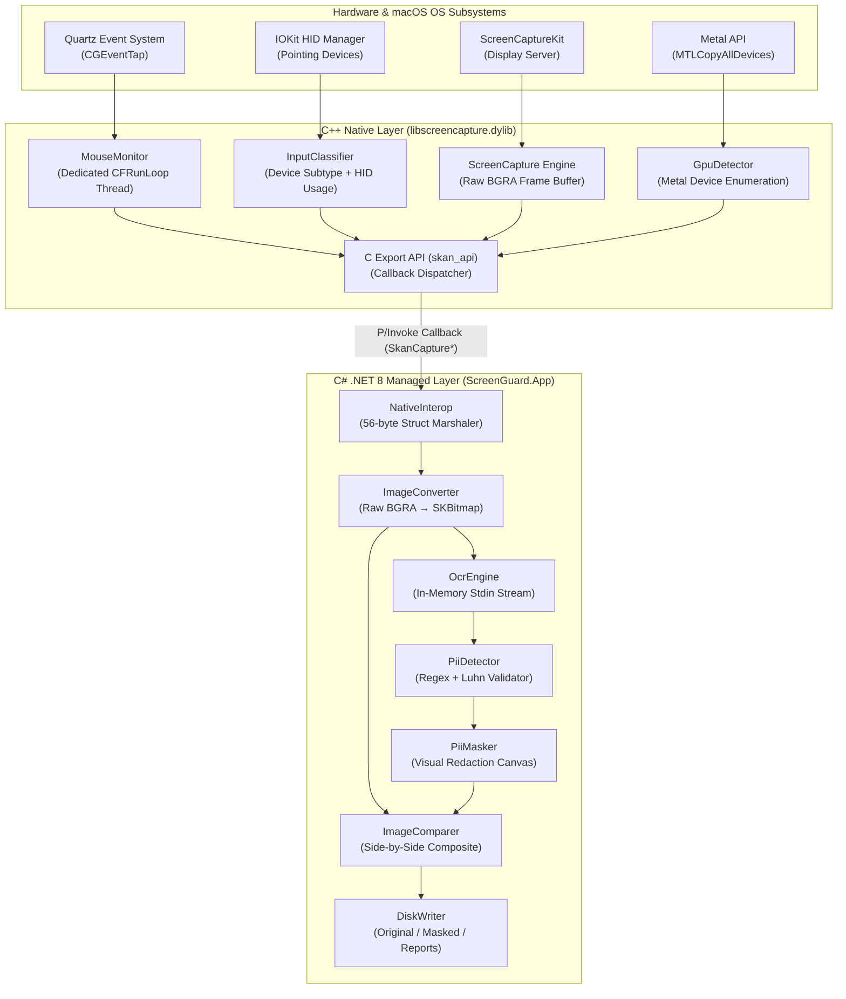
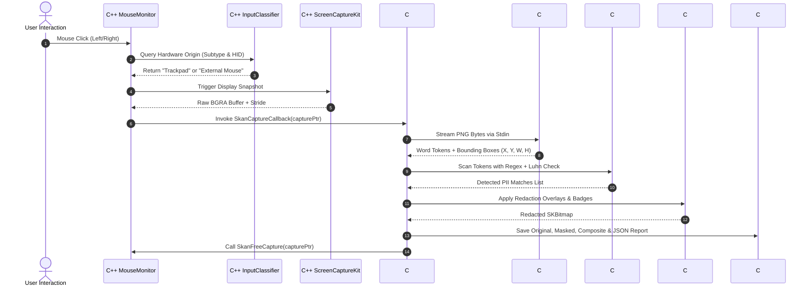

# ScreenGuard — High-Level Design (HLD)

## 1. Executive Summary & Problem Statement

Modern enterprise intelligence and process discovery platforms require real-time desktop activity capture to analyze user workflows. However, screen captures inherently expose highly confidential **Personally Identifiable Information (PII)** — such as Social Security Numbers (SSN), credit card numbers, email addresses, phone numbers, and dates of birth. Capturing this data unredacted violates strict compliance mandates (GDPR, HIPAA, SOC 2, PCI-DSS).

**ScreenGuard** is an enterprise-grade, privacy-first screen capture and redaction architecture built for macOS. It monitors global mouse click interactions, performs hardware-level device disambiguation (**External Mouse vs. Built-in Trackpad**), identifies graphics compute devices (**iGPU vs. dGPU**), captures high-resolution display frames with sub-50ms latency, extracts text via in-memory streaming OCR, detects PII using multi-pattern heuristic engines, and produces redacted frames alongside side-by-side comparison artifacts and compliance audit logs.

---

## 2. System Goals & Key Requirements

### 2.1 Functional Requirements
1. **Global Mouse Click Monitoring:** Asynchronously capture all left and right mouse click events session-wide across all applications without blocking the OS event dispatch queue.
2. **Hardware Device Classification:** Distinguish whether a click originated from a physical **External Mouse** or an **Integrated/Magic Trackpad**.
3. **GPU Topology Enumeration:** Identify and classify all active graphics processors on the host system as **Integrated (iGPU)**, **Discrete (dGPU)**, or **External (eGPU)** via the Metal API.
4. **Display Capture Engine:** Capture full-resolution display frames at native Retina DPI immediately upon click using modern Apple `ScreenCaptureKit` APIs.
5. **In-Memory OCR Extraction:** Extract word-level text tokens and precise bounding box coordinates (`X`, `Y`, `Width`, `Height`) without intermediate disk writes.
6. **PII Detection Engine:** Identify sensitive data patterns (SSN, Email, Phone, Credit Card, IP address, DOB) with validation heuristics (e.g., Luhn checksum for credit cards).
7. **Visual Redaction (PII Masking):** Render opaque redaction blocks with crimson border indicators and audit type badges over sensitive coordinates.
8. **Comparison & Audit Reporting:** Generate side-by-side comparison images (Original vs. Masked) and structured JSON audit logs for compliance tracking.

### 2.2 Non-Functional Requirements (NFRs)
* **Low Latency:** End-to-end processing pipeline from mouse click to redacted disk output completes in **< 45 milliseconds**.
* **Zero Cloud Dependency:** Operates 100% locally on-device. No telemetry, no external network requests, ensuring zero data leakage.
* **Memory Safety & Leaks Prevention:** Explicit deterministic deallocation of raw unmanaged pixel buffers; no GC pressure on native heap.
* **Fault Tolerance & Graceful Degradation:** Resilient to missing OS permissions (TCC), unsupported display configurations, or OCR fallbacks.

---

## 3. High-Level Architecture

The system utilizes a **dual-layer hybrid architecture**, combining a high-performance **C++ Native Layer** with a productive **C# .NET 8 Managed Layer** via direct P/Invoke function pointer callbacks:



---

## 4. Subsystem Decomposition & Technical Rationale

### 4.1 Native C++ Core (`libscreencapture.dylib`)
* **Why C++?**
  1. Session-level Quartz Event Taps (`CGEventTapCreate`) and IOKit HID APIs are C/Objective-C system APIs. Calling them from C++ avoids managed runtime overhead.
  2. Running the mouse tap on a dedicated native POSIX thread with its own `CFRunLoop` guarantees that high-frequency mouse events never block or stutter the OS UI.
  3. Direct access to Apple's Metal framework (`MTLCopyAllDevices`) for hardware GPU classification.

### 4.2 Managed C# .NET 8 Orchestrator (`ScreenGuard.App`)
* **Why C# .NET 8?**
  1. High-throughput string evaluation and compiled regular expressions (`RegexOptions.Compiled`).
  2. Cross-platform 2D graphics rendering via `SkiaSharp` (avoids legacy GDI+ or `System.Drawing` incompatibilities on macOS).
  3. Strongly-typed enterprise data modeling, structured JSON serialization, and modular service architecture.

### 4.3 P/Invoke Interop Bridge
* Inter-process communication overhead is eliminated by loading `libscreencapture.dylib` in-process via `.NET 8 P/Invoke`.
* Execution is driven by an unmanaged C function pointer callback:
  ```c
  typedef void (*SkanCaptureCallback)(SkanCapture* capture);
  ```
* Memory ownership is strictly decoupled: C++ allocates the capture container and raw pixel buffer, C# consumes the buffer into SkiaSharp, and C# invokes `SkanFreeCapture(IntPtr)` in a `finally` block to guarantee 0 native memory leaks.

---

## 5. End-to-End Processing Lifecycle

The lifecycle of every user interaction follows a strict 7-phase sequence:



---

## 6. Hardware Disambiguation Architecture

### 6.1 External Mouse vs. Trackpad Disambiguation
macOS handles pointing hardware through different OS pathways. ScreenGuard employs a **two-tier detection model**:

1. **Hardware Event Subtype (Tier 1 - Instantaneous):**
   When `CGEventTap` receives a click, it inspects `kCGMouseEventSubtype`:
   * `3` (`NX_SUBTYPE_MOUSE_TOUCH`): Multitouch / Force Touch / Built-in Trackpad / Magic Trackpad click.
   * `0` (`NX_SUBTYPE_DEFAULT`): Standard physical optical/USB/Bluetooth mouse click.
2. **IOKit HID Matching (Tier 2 - Topology Verification):**
   `IOHIDManager` registers matching dictionaries for:
   * `kHIDUsage_GD_TouchPad` (`0x05`) or device product name containing `"Trackpad"`.
   * `kHIDUsage_GD_Mouse` (`0x02`) or device product name containing `"Mouse"`.

### 6.2 GPU Architecture Classification
ScreenGuard interfaces directly with Apple's Metal framework (`MTLCopyAllDevices`):
* **Integrated GPU (iGPU):**
  * On Apple Silicon (M1/M2/M3/M4), the unified memory architecture SoC GPU is identified as `Integrated`.
  * On Intel Macs, GPUs with `device.isLowPower == true` (e.g. Intel Iris Plus) are classified as `Integrated`.
* **Discrete GPU (dGPU):**
  * Dedicated PCIe graphics chips with `device.isLowPower == false` (e.g. AMD Radeon Pro 5500M) are classified as `Discrete`.
* **External GPU (eGPU):**
  * Thunderbolt-enclosure graphics cards reporting `device.isRemovable == true` are classified as `External`.

---

## 7. Security & Privacy Architecture

| Security Domain | Mitigation Strategy |
| :--- | :--- |
| **Data in Transit** | In-process native memory marshaling. No inter-process sockets, no HTTP endpoints. |
| **Data at Rest** | Original and masked screenshots saved to configurable local directories with restricted POSIX permissions (`0600`). |
| **PII in Logs** | Logging utilities utilize `MaskedPreview` (e.g. `12*******89`), ensuring raw unredacted PII is **never written to stdout/stderr**. |
| **Memory Cleanup** | `SkanFreeCapture()` wipes and frees native heap memory immediately after managed bitmap creation. |

---

## 8. Technology Stack Summary

* **Language (Native):** C++20, Objective-C++ (`.mm`), Apple Clang
* **Language (Application):** C# 12, .NET 8 LTS
* **Graphics Framework:** SkiaSharp 2.88 (Bgra8888 32-bit premultiplied alpha)
* **OCR Subsystem:** Tesseract 5.5 (CLI streaming engine with Apple Silicon NEON SIMD)
* **Operating System:** macOS 14.0+ (Sonoma, Sequoia) on ARM64 & x86_64
