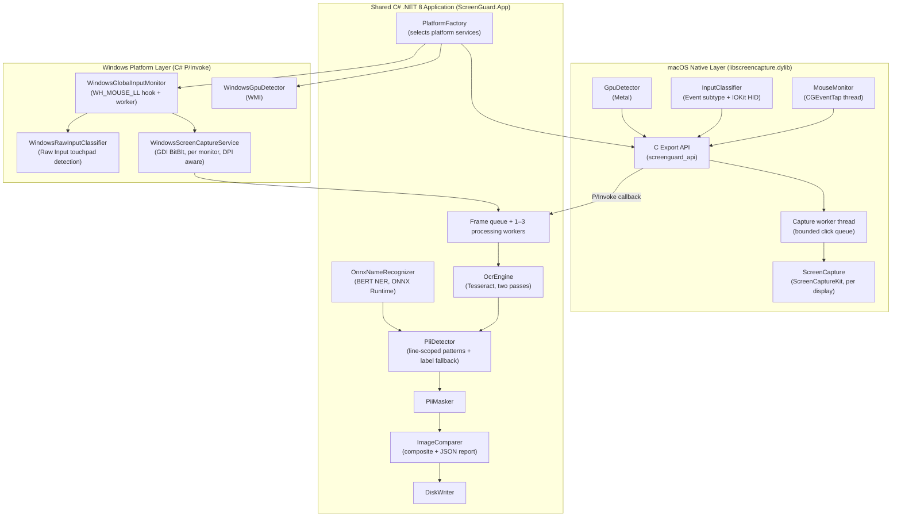
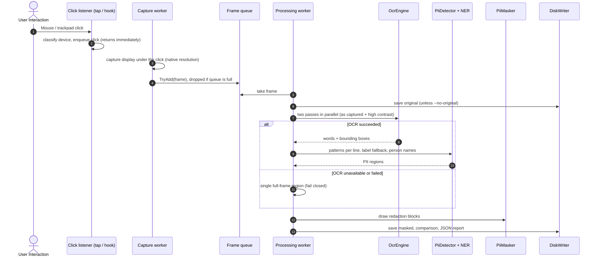

# ScreenGuard — High-Level Design (HLD)

## 1. Executive Summary & Problem Statement

Modern enterprise intelligence and process discovery platforms require real-time desktop activity capture to analyze user workflows. However, screen captures inherently expose highly confidential **Personally Identifiable Information (PII)** — such as Social Security Numbers (SSN), credit card numbers, email addresses, phone numbers, dates of birth and people's names. Capturing this data unredacted violates compliance mandates (GDPR, HIPAA, SOC 2, PCI-DSS).

**ScreenGuard** is a privacy-first screen capture and redaction application for **macOS and Windows laptops**. It monitors global mouse click interactions, distinguishes the pointing device (**External Mouse vs. Built-in Trackpad**), identifies graphics devices (**iGPU vs. dGPU vs. eGPU**), captures the clicked display at native resolution, extracts text with on-device OCR, detects PII with pattern rules plus an on-device named-entity model, and produces redacted frames alongside side-by-side comparison artifacts and JSON audit reports.

---

## 2. System Goals & Key Requirements

### 2.1 Functional Requirements
1. **Global Mouse Click Monitoring:** Capture all left and right clicks session-wide across all applications without blocking or delaying the user's input.
2. **Hardware Device Classification:** Distinguish whether a click originated from an **External Mouse** or a **Trackpad / Touchpad**.
3. **GPU Topology Enumeration:** Classify graphics processors as **Integrated (iGPU)**, **Discrete (dGPU)** or **External (eGPU)** — Metal on macOS, WMI on Windows.
4. **Display Capture Engine:** Capture the display under the click at native pixel resolution (Retina / DPI-scaled panels included).
5. **On-Device OCR Extraction:** Extract word-level text and bounding boxes without writing screenshots to temporary files.
6. **PII Detection Engine:** Detect SSN, email, phone, credit card (Luhn-validated), IP address, date of birth, passport, tax id, address, job title, credentials and person names.
7. **Visual Redaction (PII Masking):** Render opaque redaction blocks with crimson borders and type badges over detected values, leaving field labels readable.
8. **Comparison & Audit Reporting:** Save original, masked and side-by-side comparison images plus a JSON audit report per capture.

### 2.2 Non-Functional Requirements (NFRs)
* **Non-blocking input path:** The OS click callback only records the click and returns (microseconds), so macOS never disables the event tap and Windows never removes the mouse hook. Capture and processing run on worker threads.
* **Throughput:** OCR is the bottleneck — about 2 s per 2880×1800 frame on an M1 MacBook Air (two OCR passes in parallel); up to three frames are processed concurrently. A bounded queue drops excess clicks during heavy bursts rather than growing memory without limit.
* **Fail closed:** If OCR is unavailable or fails for a frame, the masked output redacts the **entire frame** instead of passing PII through.
* **Zero cloud dependency:** OCR and name recognition run 100 % locally. No telemetry and no network requests at runtime.
* **Memory safety:** Native pixel buffers are freed deterministically in a `finally` block after being copied into managed bitmaps.
* **Explicit permission handling:** Missing OS permissions are detected at startup with a clear message, instead of the app appearing to run while receiving no events.

---

## 3. High-Level Architecture

A shared **C# .NET 8 application layer** runs on both operating systems. Platform-specific capture and input monitoring sit behind interfaces selected by `PlatformFactory`:

* **macOS:** a **C++ / Objective-C++ native library** (`libscreencapture.dylib`) called via P/Invoke.
* **Windows:** pure **C# P/Invoke into Win32** (no custom native DLL).



---

## 4. Subsystem Decomposition & Technical Rationale

### 4.1 macOS Native Core (`libscreencapture.dylib`)
1. Session-level Quartz Event Taps, IOKit HID, ScreenCaptureKit and Metal are C / Objective-C system APIs; a small native library calls them directly.
2. The event tap runs on its own thread and `CFRunLoop`; its callback classifies and queues each click and returns immediately. A separate worker thread performs the capture, so a slow capture can never make macOS disable the tap.
3. Permissions (Input Monitoring, Screen Recording) are checked with `CGPreflight…Access` before starting; a missing permission returns a specific error code.
4. Minimum macOS 12.3: `SCScreenshotManager` (macOS 14+) is used when available, with a `CGDisplayCreateImage` fallback on 12.3–13.

### 4.2 Windows Platform Layer (C#)
1. The process opts into **per-monitor DPI awareness** at startup, so scaled laptop displays are captured completely.
2. A `WH_MOUSE_LL` hook records clicks on a dedicated message-loop thread and returns immediately; a worker thread classifies and captures.
3. **Raw Input** (precision-touchpad HID reports, raw mouse device handles) distinguishes touchpad clicks from mouse clicks, which the hook alone cannot do.
4. GDI captures the monitor under the click and forces the alpha channel opaque (GDI leaves it undefined).

### 4.3 Shared C# .NET 8 Application (`ScreenGuard.App`)
1. **SkiaSharp** for all image work on both platforms (no `System.Drawing`).
2. **Tesseract** OCR: the CLI (bundled in the macOS app) or the in-process engine (bundled DLLs on Windows).
3. **ONNX Runtime** runs a quantised BERT named-entity model to find person names that have no label or title.
4. Modular services behind interfaces (`IScreenCaptureService`, `IGlobalInputMonitor`, `IGpuDetector`, `IOcrEngine`, `IPiiDetector`, `INameRecognizer`, `IPiiMasker`, `IImageComparer`, `IDiskWriter`).

### 4.4 macOS P/Invoke Interop Bridge
* `libscreencapture.dylib` is loaded in-process via .NET 8 P/Invoke with a custom resolver (app folder, `.app` bundle paths).
* The native worker invokes an unmanaged callback:
  ```c
  typedef void (*ScreenGuardCaptureCallback)(ScreenGuardCapture* capture);
  ```
* Ownership is explicit: native code allocates the capture struct and pixel buffer; C# copies the pixels into a SkiaSharp bitmap and calls `ScreenGuardFreeCapture(IntPtr)` in a `finally` block.

---

## 5. End-to-End Processing Lifecycle



---

## 6. Hardware Disambiguation Architecture

### 6.1 External Mouse vs. Trackpad
**macOS — two tiers:**
1. **Event subtype (instantaneous):** `kCGMouseEventSubtype` of `3` (`NX_SUBTYPE_MOUSE_TOUCH`) means a trackpad click; `0` means a standard mouse.
2. **IOKit HID (verification):** the device that last reported a button press is classified by product name ("Trackpad") or HID usage (`0x05` touchpad, `0x02` mouse).

**Windows — Raw Input timing:**
* Precision touchpads expose a HID digitizer collection (usage page `0x0D`, usage `0x05`); contact reports are timestamped.
* Raw mouse button events carry a device handle; Windows-synthesized touchpad input has none.
* Legacy touchpads that present as mice are recognised by vendor id (Synaptics, ELAN, ALPS).
* At each click the most recent activity within a short window decides `Trackpad` vs `External Mouse`. Touchscreen and pen clicks are reported as `Touchscreen`.

### 6.2 GPU Classification
**macOS (Metal, `MTLCopyAllDevices`):** `isRemovable` → External; `isLowPower` → Integrated; a single non-low-power GPU (Apple Silicon unified GPU) → Integrated; otherwise Discrete.

**Windows (WMI `Win32_VideoController`):** classified by adapter name, checking integrated parts first because AMD and Intel ship both kinds under one brand — e.g. "AMD Radeon(TM) Graphics" / "Radeon 780M" → Integrated, "Radeon RX …" → Discrete, "Intel Arc A770" → Discrete, other Intel → Integrated, NVIDIA → Discrete.

---

## 7. PII Detection Strategy

| Layer | What it catches | Guard against false positives |
| :--- | :--- | :--- |
| Line-scoped patterns | SSN, email, phone, card, IP, DOB, passport, tax id, address, credentials, labelled names and titles | Luhn for unlabelled cards, separators for unlabelled SSNs, version-number context for IPs, stop-words for city + postcode |
| Label fallback | A value OCR garbled (selection highlight, cursor, text caret) or that is missing entirely, when its label (`Email:`, `Passport:`) is readable — including labels clipped at the left screen edge | Requires a colon; clipped labels only at line start |
| On-device NER | Free-standing person names (feeds, chat lists, email headers) | Only `PER` entities are masked; companies and places stay visible |

Matches never span two text lines, and only the words a match covers are boxed, so labels stay readable and boxes stay tight.

---

## 8. Security & Privacy Architecture

| Security Domain | Mitigation Strategy |
| :--- | :--- |
| **Data in Transit** | Everything runs in-process. No sockets, no HTTP endpoints, no telemetry. |
| **Data at Rest** | Images and reports are written to a local output directory chosen by the user. The unmasked original can be skipped with `--no-original`. Files use the user's default permissions. |
| **PII in Logs and Reports** | Console output and JSON reports use `MaskedPreview` (e.g. `12*******89`); raw PII values are never printed. |
| **OCR Failure** | Fail closed: the whole frame is redacted and the report records `"redactionMode": "full-frame"`. |
| **Memory Cleanup** | `ScreenGuardFreeCapture()` frees the native pixel buffer immediately after it is copied into a managed bitmap. |
| **Supply Chain** | The NER model is downloaded at build time from a pinned commit and verified by SHA-256. |

---

## 9. Technology Stack Summary

* **Native (macOS):** C++17, Objective-C++ (`.mm`), Apple Clang, CMake
* **Application:** C# 12, .NET 8 LTS (self-contained publish)
* **Graphics:** SkiaSharp 2.88
* **OCR:** Tesseract 5 (CLI bundled in the macOS app; NuGet engine on Windows)
* **Name recognition:** ONNX Runtime 1.20 + `dslim/bert-base-NER` (int8 ONNX, MIT)
* **Operating systems:** macOS 12.3+ (Apple Silicon release build; Intel builds from source) and Windows 10/11 x64
