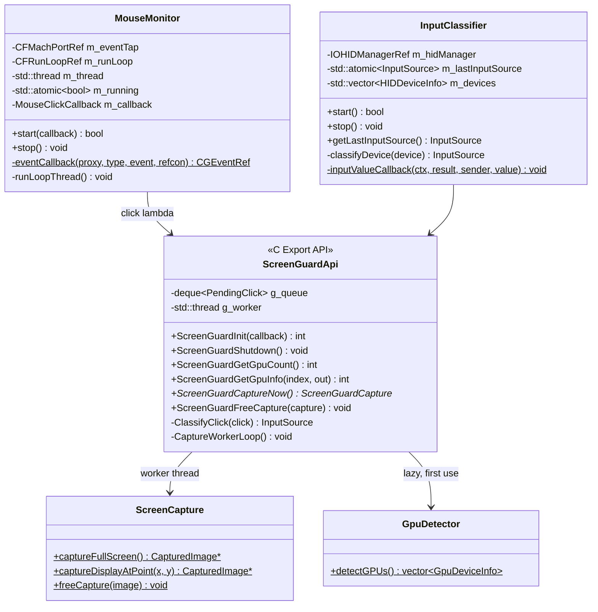

# ScreenGuard — Low-Level Design (LLD)

## 1. Class & Component Architecture

### 1.1 macOS Native Subsystems (`libscreencapture.dylib`)


### 1.2 Shared C# Application and Platform Services

```mermaid
classDiagram
    class IScreenCaptureService {
        <<interface>>
        +CaptureScreen() CapturedFrame?
        +CaptureScreenAt(x, y) CapturedFrame?
    }
    class IGlobalInputMonitor {
        <<interface>>
        +OnFrameCaptured event
        +Start() bool
        +Stop() void
    }
    class IGpuDetector {
        <<interface>>
        +DetectGpus() IReadOnlyList~GpuInfoModel~
    }
    class INameRecognizer {
        <<interface>>
        +FindNames(lines) List~List~OcrResult~~
    }
    class IVisualPiiDetector {
        <<interface>>
        +Name string
        +Detect(frame) List~PiiMatch~
    }
    class CaptureProcessor {
        +Process(bitmap, source, x, y, ts, log) CaptureResult
    }
    class OnnxFaceDetector {
        -InferenceSession _session
        -FaceDetectorOptions _options
        +Detect(frame) List~PiiMatch~
    }
    class VisualDetectorFactory {
        <<static>>
        +CreateAll(settings, info, warning) IReadOnlyList~IVisualPiiDetector~
    }
    class ImageTiler {
        <<static>>
        +Cover(w, h, inW, inH, scale, overlap)$ List~Tile~
        +Whole(w, h, inW, inH)$ Tile
    }
    class NonMaxSuppression {
        <<static>>
        +Apply(boxes, iou, containment)$ List~ScoredBox~
    }

    class PlatformFactory {
        <<static>>
        +InitializeProcess() void
        +CreateCaptureService() IScreenCaptureService
        +CreateInputMonitor(capture) IGlobalInputMonitor
        +CreateGpuDetector() IGpuDetector
    }

    class MacGlobalInputMonitor
    class MacScreenCaptureService
    class MacGpuDetector
    class WindowsGlobalInputMonitor {
        -BlockingCollection~PendingClick~ _pending
        -HookCallback(nCode, wParam, lParam) IntPtr
        -CaptureLoop() void
    }
    class WindowsRawInputClassifier {
        +Start() bool
        +Classify(clickTick) string
        -HandleRawInput(hRawInput) void
    }
    class WindowsScreenCaptureService {
        +CaptureScreenAt(x, y) CapturedFrame?
        +ForceOpaque(pixels, rowBytes, w, h)$ void
    }
    class WindowsGpuDetector {
        +Classify(name)$ string
    }
    class WindowsDpiAwareness {
        +Enable()$ void
    }

    class OcrEngine {
        +ExtractTextWithBounds(bitmap) List~OcrResult~
        +CreateHighContrastCopy(source)$ SKBitmap
        +MergePasses(primary, secondary)$ List~OcrResult~
        -ExtractUsingCli(bitmap) List~OcrResult~
        -ExtractUsingNative(bitmap) List~OcrResult~
    }
    class PiiDetector {
        -INameRecognizer? _nameRecognizer
        +DetectPii(ocrResults) List~PiiMatch~
        +GroupIntoLines(words)$ List~List~OcrResult~~
        -ApplyLabelFallback(text, spans, all, matches)$ void
        -DeduplicateMatches(matches)$ List~PiiMatch~
    }
    class OnnxNameRecognizer {
        -InferenceSession _session
        -BertWordPieceTokenizer _tokenizer
        +FindNames(lines) List~List~OcrResult~~
    }
    class BertWordPieceTokenizer {
        +TokenizeWord(word) List~int~
    }
    class PiiMasker {
        +ApplyMask(original, matches) SKBitmap
    }
    class ImageComparer {
        +CreateSideBySideComparison(...) SKBitmap
        +GenerateJsonReport(result, matches, path) string
    }
    class DiskWriter {
        +SaveOriginal(bitmap, ts) string
        +SaveMasked(bitmap, ts) string
        +SaveComparison(bitmap, ts) string
        +SaveReport(json, ts) string
    }

    IScreenCaptureService <|.. MacScreenCaptureService
    IScreenCaptureService <|.. WindowsScreenCaptureService
    IGlobalInputMonitor <|.. MacGlobalInputMonitor
    IGlobalInputMonitor <|.. WindowsGlobalInputMonitor
    IGpuDetector <|.. MacGpuDetector
    IGpuDetector <|.. WindowsGpuDetector
    INameRecognizer <|.. OnnxNameRecognizer
    WindowsGlobalInputMonitor --> WindowsRawInputClassifier
    WindowsGlobalInputMonitor --> IScreenCaptureService
    OnnxNameRecognizer --> BertWordPieceTokenizer
    PiiDetector --> INameRecognizer
    PlatformFactory --> WindowsDpiAwareness
    IVisualPiiDetector <|.. OnnxFaceDetector
    OnnxFaceDetector --> ImageTiler
    OnnxFaceDetector --> NonMaxSuppression
    VisualDetectorFactory --> OnnxFaceDetector
    CaptureProcessor --> IVisualPiiDetector
    CaptureProcessor --> PiiDetector
    CaptureProcessor --> OcrEngine
```


---

## 2. 64-Bit Memory Layout & Struct Alignment ABI (macOS)

Unmanaged/managed interop must match the exact memory alignment of the 64-bit Darwin ABI.

### 2.1 `ScreenGuardCapture` Memory Alignment Table (56 Bytes)
```
Offset (Hex)  Offset (Dec)  Size   Type               Field Name     Note
─────────────────────────────────────────────────────────────────────────────────────────────
0x00          0             4      int32_t            Width          pixels
0x04          4             4      int32_t            Height         pixels
0x08          8             4      int32_t            Stride         bytes per row
0x0C          12            4      [PAD]              —              4 bytes pad for 8-byte pointer
0x10          16            8      uint8_t* / IntPtr  PixelData      BGRA, malloc'd by native code
0x18          24            4      int32_t            InputSource    0=Unknown, 1=Mouse, 2=Trackpad
0x1C          28            4      [PAD]              —              4 bytes pad for 8-byte double
0x20          32            8      double             ClickX         captured-image pixel coordinates
0x28          40            8      double             ClickY         captured-image pixel coordinates
0x30          48            8      int64_t            TimestampMs    Unix epoch milliseconds
─────────────────────────────────────────────────────────────────────────────────────────────
Total Struct Size: 56 Bytes (0x38)
```

#### Native Definition (`native/include/screenguard_api.h`)
```c
typedef struct {
    int         width;
    int         height;
    int         stride;         /**< Bytes per row (may include padding) */
    uint8_t*    pixelData;      /**< Raw BGRA pixel buffer (malloc'd) */
    int         inputSource;    /**< SG_INPUT_* constant */
    double      clickX;         /**< Click X in captured-image pixel coordinates */
    double      clickY;         /**< Click Y in captured-image pixel coordinates */
    int64_t     timestampMs;    /**< Unix epoch milliseconds */
} ScreenGuardCapture;
```

#### Managed Binding (`app/Interop/NativeInterop.cs`)
```csharp
[StructLayout(LayoutKind.Sequential)]
public struct ScreenGuardCaptureStruct
{
    public int    Width;
    public int    Height;
    public int    Stride;
    public IntPtr PixelData;
    public int    InputSource;
    public double ClickX;
    public double ClickY;
    public long   TimestampMs;
}
```

The layout is verified by test: `Marshal.SizeOf` = 56, `PixelData` offset = 16, `ClickX` offset = 32.

Click coordinates arrive from the event tap in global points; the worker converts them into the
captured display's pixel space: `(x - display.originX) * scale`, where `scale` is pixels per point
(2.0 on Retina).

---

## 3. C API Export Interface (`screenguard_api.h`)

```cpp
// Lifecycle
int  ScreenGuardInit(ScreenGuardCaptureCallback callback);
     //  0 = success
     // -1 = already initialized
     // -2 = failed to start mouse monitor
     // -3 = Input Monitoring permission not granted (system prompt shown)
     // -4 = Screen Recording permission not granted (system prompt shown)
void ScreenGuardShutdown(void);   // stop tap → join worker → stop HID → clear callback

// Hardware query (valid before Init: GPUs are enumerated on first use)
int  ScreenGuardGetGpuCount(void);
int  ScreenGuardGetGpuInfo(int index, ScreenGuardGpuInfo* out); // type: 0=iGPU, 1=dGPU, 2=eGPU

// Capture & memory lifecycle
ScreenGuardCapture* ScreenGuardCaptureNow(void);          // main display, used by --test
void ScreenGuardFreeCapture(ScreenGuardCapture* capture);  // frees pixelData and the struct
```

---

## 4. Threading & Concurrency Model

### 4.1 macOS Native Threads
1. **Event tap thread** (`MouseMonitor`): own `CFRunLoop`, listen-only session tap. The callback
   classifies the click (an atomic read) and pushes it to a bounded queue (16), then returns. If the
   queue is full the click is dropped and counted.
2. **Capture worker** (`CaptureWorkerLoop`): waits on a condition variable, captures the display
   under the click with ScreenCaptureKit, builds the capture struct and invokes the C# callback.
3. **IOKit HID thread** (`InputClassifier`): own `CFRunLoop`; records which device last pressed a button.

### 4.2 Windows Threads
1. **Hook thread:** owns the Win32 message loop for both the `WH_MOUSE_LL` hook and the Raw Input
   message-only window. The hook callback only `TryAdd`s the click to a bounded queue (16).
2. **Capture worker:** waits ~40 ms after each click so the matching `WM_INPUT` has arrived,
   classifies the device, captures the monitor via GDI and raises `OnFrameCaptured`.

### 4.3 Shared Processing
1. **Frame queue:** `BlockingCollection<CapturedFrame>` with capacity 8. Capture threads use
   `TryAdd` and never block; a full queue drops the frame and counts it.
2. **Processing workers:** `clamp(ProcessorCount / 2, 1, 3)` threads each call
   `CaptureProcessor.Process`, which runs OCR + text detection and every visual detector
   concurrently (one task per visual detector), then masking and disk I/O. Each buffers its console output in a `CaptureLog` and prints it as one block.
3. **Thread safety:** the CLI OCR path starts one Tesseract process per call (safe concurrently);
   the in-process Tesseract engine is guarded by a lock; `InferenceSession.Run` is thread-safe;
   `_captureHistory` is protected by `lock`; counters use `Interlocked`.
4. **Callback rooting (macOS):** the delegate passed to `ScreenGuardInit` is held by a `GCHandle`
   so the GC cannot collect it while native code holds the function pointer.
5. **Shutdown:** stop the input monitor (no new frames) → `CompleteAdding()` → join processing
   workers (queued frames are still saved) → dispose OCR and NER.

---

## 5. OCR Subsystem

### 5.1 Two passes, in memory
Each frame is OCR'd twice, concurrently: as captured, and as a high-contrast black-on-white copy.
PNG bytes are streamed to Tesseract's stdin; nothing is written to temporary files on the CLI path.

```csharp
using var highContrast = CreateHighContrastCopy(bitmap);
var primaryTask = Task.Run(() => ExtractUsingCli(bitmap));
var secondaryTask = Task.Run(() => ExtractUsingCli(highContrast));
...
return MergePasses(primary, secondary);
```

**High-contrast copy:** luminance `(77R + 150G + 29B) >> 8` thresholded at 128, then in each 48 px
tile the majority class becomes background (white) and the minority ink (black). This normalises
light-on-dark text, dark-on-light text and text inside a selection highlight.

**Merge:** a second-pass word is added only if it overlaps no first-pass word by more than 30 % of
its own area. Line ids are then cleared so lines are regrouped geometrically.

### 5.2 TSV extraction
TSV output is requested with `-c tessedit_create_tsv=1 -c tessedit_create_txt=0` (the `tsv` config
file exists only in a full Tesseract install and silently degrades to plain text without it).

```
level  page_num  block_num  par_num  line_num  word_num  left  top  width  height  conf  text
5      1         1          1        1         1         51    115  86     15      96.2  Customer
```

Rows with `level == 5` become `OcrResult { Text, X, Y, Width, Height, Confidence, LineId }`, where
`LineId = (block * 1000 + par) * 1000 + line`.

### 5.3 Failure handling
A non-zero exit code, a 60 s timeout or output that is not TSV throws. The caller then redacts the
whole frame (§8) instead of treating the failure as "no text".

---

## 6. PII Detection Engine

### 6.1 Line grouping
* With OCR line ids, words are grouped by id; otherwise geometrically. A word joins a line when
  its height is 0.4–2.5× the line's **median** word height and its centre is within 0.6× of the line's
  median centre. Taller tokens join only if their top edge aligns with the line, and never widen it.
* Each line is sorted by X and split where the gap from the furthest right edge so far exceeds
  4× the median height, separating side-by-side columns.

### 6.2 Matching and boxing
Words in a line are joined with single spaces while recording each word's character span. Every
pattern runs with `Regex.Matches` over the whole line. The match (or its named `v` group) is mapped
to the words whose spans it overlaps:

$$\text{Box} = \left(\min X_i,\ \min Y_i,\ \max(X_i + W_i) - \min X_i,\ \max(Y_i + H_i) - \min Y_i\right)$$

over only the covered words — so a match never spans lines, and a label outside the `v` group stays
readable.

### 6.3 Patterns

| PII Type | Rule | False-positive guard |
| :--- | :--- | :--- |
| **SSN** | `SSN:` / `Social Security:` + 9 digits, or `ddd-dd-dddd` with separators | Unlabelled form requires separators and excludes SSA-invalid ranges |
| **Email** | RFC-5322-style local@domain.tld | — |
| **Phone** | US `(ddd) ddd-dddd` and international `+cc …` | Not inside a longer digit run |
| **Credit Card** | Labelled (`Credit Card:`) any 4-4-4-x digits; unlabelled Visa/MC/Amex/Discover; three groups + a digit-look-alike group (`lllfl`) | Unlabelled must pass **Luhn** |
| **IPv4** | Dotted quad, octets 0–255 | Rejected after `v`, `version`, `build`, `release`, … |
| **Date of Birth** | `MM/DD/YYYY`, `YYYY-MM-DD` | — |
| **Passport / Tax ID** | `A12345678`, `12-3456789` | — |
| **Address** | Street (`221 Baker Street`), `City 600032`, `PIN/ZIP:` | City word not in a stop-list (`Invoice`, `Order`, …) |
| **Name** | `Customer Name:` etc., `Mr./Dr./Prof.` + name, `X & N others`, plus NER (§7) | — |
| **Job Title** | `Job Title:`, `Position:`, `Designation:` | Bare `Title:` mid-line ignored |
| **Credentials** | `Password:` / `API Key:` / `Token:` + value | — |

### 6.4 Luhn checksum (mod 10)
$$\sum_{i=1}^{n} d_i' \equiv 0 \pmod{10}$$
where every second digit from the right is doubled (subtracting 9 if the result exceeds 9).

### 6.5 Label fallback
For each field label on a line (`Email:`, `Passport:`, `Credit Card:`, …, plus left-edge-clipped
forms such as `ssport:` matched only at line start) whose value region has no match yet:
* if words follow the label (up to the next label), they are masked under the label's type;
* if no word follows, a box starting just right of the label and extending to the neighbouring
  lines' right edge (at least 15 line-heights) is masked.

### 6.6 Deduplication
Two matches merge into their union only when they overlap horizontally **and** vertically by at
least half the smaller height (same line). The longer match's type and text are kept.

---

## 7. Person-Name Recognition (NER)

* **Model:** `dslim/bert-base-NER`, int8 ONNX (`Xenova/bert-base-NER`, pinned commit, SHA-256
  verified), labels `O, B/I-MISC, B/I-PER, B/I-ORG, B/I-LOC`. Only `PER` is used.
* **Tokenizer:** in-project cased BERT WordPiece. Each OCR word is tokenized separately, recording
  the index of its first sub-token, so every score maps back to a word box.
* **Inference:** one sequence per line (`[CLS] … [SEP]`, max 128 tokens, longer lines chunked by
  word), batches of 16, inputs `input_ids`, `attention_mask`, `token_type_ids`.
* **Decision:** for each word, `P(B-PER) + P(I-PER)` at its first sub-token (softmax over logits)
  must be ≥ 0.7, and the word must start with a capital letter and have at least two characters.
  Consecutive name words form one span → one `Name` match.
* **Fallback:** if the model files are missing, the app warns and runs in labels-only mode; each
  report records `"nameRecognition": "ner" | "labels-only"`.

---

## 7a. Face Detection

* **Model:** UltraFace `version-RFB-640` (ONNX model zoo, MIT; pinned commit, SHA-256 verified).
  Input `1×3×480×640` RGB, normalised `(v − 127) / 128`; outputs `scores [1, N, 2]` and
  `boxes [1, N, 4]` (corners normalised to the input).
* **Tiling (`ImageTiler`):** one whole-frame pass (padded to 4:3) for large faces, plus overlapping
  640×480 tiles at scale 0.5 and 1.0 (25 % overlap) so 20–40 px avatars are seen at a size the model
  can detect. A 2880×1800 frame needs about 9 + 30 tiles; ~0.85 s on an M1, run in parallel with OCR.
* **Filtering:** score ≥ 0.9 (0.8–0.9 included statues and fractal art in testing), boxes < 16 px
  dropped, then `NonMaxSuppression` (IoU > 0.3, or > 70 % of the smaller box contained) merges
  duplicates from overlapping tiles.
* **Output:** each box is enlarged by 25 % per side (hair, ears, chin) and returned as a
  `PiiMatch { Type = "Face" }`, so the existing masker, comparer and report handle it unchanged.
* **Configuration:** all thresholds live in `FaceDetectorOptions`; `--no-faces` disables the detector;
  reports list active detectors in `"visualDetectors"`.

---

## 8. Visual Redaction Geometry & Fail-Closed Mode

1. **Padding:** each region extends by $\Delta = 4\text{px}$ on all sides.
2. **Clamping:**
   $$\text{Left} = \max(0, X - \Delta), \quad \text{Right} = \min(W_{\text{image}}, X + W + \Delta)$$
   $$\text{Top} = \max(0, Y - \Delta), \quad \text{Bottom} = \min(H_{\text{image}}, Y + H + \Delta)$$
3. **Layers:** solid black fill → crimson 2 px outline (`#E53935`) → badge `REDACTED: <TYPE>`.
4. **Fail closed:** if OCR is unavailable or throws, or any visual detector throws, the region
   list is a single `FullFrame` box covering the whole image and the report records
   `"redactionMode": "full-frame"`. A detector whose model is missing at startup is not loaded
   (with a warning) rather than failing every frame.

---

## 9. Side-by-Side Comparison Composite Geometry

$$W_{\text{composite}} = 2 \cdot W_{\text{original}} + W_{\text{divider}} \quad (W_{\text{divider}} = 4\text{px})$$
$$H_{\text{composite}} = H_{\text{original}} + H_{\text{header}} + H_{\text{footer}} \quad (H_{\text{header}} = 50\text{px}, H_{\text{footer}} = 44\text{px})$$

* **Header left:** green dot + `ORIGINAL CAPTURE (Unmasked)`
* **Header right:** red dot + `REDACTED VIEW (PII Masked)`
* **Footer:** capture id, input source, resolution, PII count by type.

---

## 10. Platform-Specific Details (Windows)

1. **DPI:** `SetProcessDpiAwarenessContext(PER_MONITOR_AWARE_V2)`, falling back to
   `SetProcessDpiAwareness` and `SetProcessDPIAware`, before any window or DC is created.
2. **Capture:** `MonitorFromPoint` → `GetMonitorInfo` → `BitBlt(SRCCOPY | CAPTUREBLT)` →
   `GetDIBits` (32-bit top-down DIB) into an opaque `SKBitmap`, then alpha forced to `0xFF`.
3. **Device classification windows:** mouse button within ±150 ms → External Mouse; synthesized
   button within ±150 ms or touchpad contact from −100 to +600 ms → Trackpad; otherwise Unknown
   (External Mouse if no touchpad is attached).
4. **Console:** UTF-8 output encoding so box-drawing characters render.
