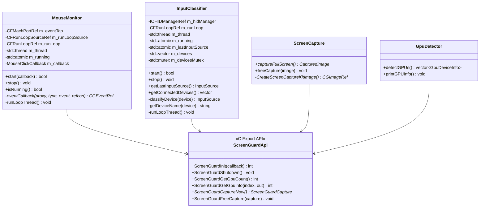

# ScreenGuard — Low-Level Design (LLD)

## 1. Class & Component Architecture

### 1.1 Native C++ Subsystems


### 1.2 Managed C# .NET 8 Subsystems

```mermaid
classDiagram
    class NativeInterop {
        <<static>>
        +ScreenGuardInit(callback) int
        +ScreenGuardShutdown() void
        +ScreenGuardGetGpuCount() int
        +ScreenGuardGetGpuInfo(index, out) int
        +ScreenGuardCaptureNow() IntPtr
        +ScreenGuardFreeCapture(ptr) void
    }

    class ImageConverter {
        +FromRawBgra(data, width, height, stride) SKBitmap?
    }

    class OcrEngine {
        -string _tesseractBinaryPath
        -bool _useCli
        +ActiveBackend string
        +ExtractTextWithBounds(bitmap) List~OcrResult~
        +ExtractText(bitmap) string
        -ExtractUsingCli(bitmap) List~OcrResult~
        -ExtractUsingNative(bitmap) List~OcrResult~
    }

    class PiiDetector {
        -List~PatternDefinition~ Patterns
        +DetectPii(ocrResults) List~PiiMatch~
        -ValidateCreditCardLuhn(number) bool
        -DeduplicateMatches(matches) List~PiiMatch~
    }

    class PiiMasker {
        -SKColor _maskColor
        -SKColor _accentColor
        -int _padding
        +ApplyMask(original, matches) SKBitmap
    }

    class ImageComparer {
        +CreateSideBySideComparison(orig, masked, matches, id, src) SKBitmap
        +GenerateJsonReport(result, matches, path) string
    }

    class DiskWriter {
        -string _originalDir
        -string _maskedDir
        -string _comparisonDir
        -string _reportsDir
        +SaveOriginal(bitmap, ts) string
        +SaveMasked(bitmap, ts) string
        +SaveComparison(bitmap, ts) string
        +SaveReport(json, ts) string
    }

    Program --> NativeInterop
    Program --> ImageConverter
    Program --> OcrEngine
    Program --> PiiDetector
    Program --> PiiMasker
    Program --> ImageComparer
    Program --> DiskWriter
```


---

## 2. 64-Bit Memory Layout & Struct Alignment ABI

A critical technical challenge in unmanaged/managed interop is matching the exact memory alignment mandated by the 64-bit Darwin ABI.

### 2.1 `ScreenGuardCapture` Memory Alignment Table (56 Bytes)
```
Offset (Hex)  Offset (Dec)  Size   Type               Field Name     Padding Note
─────────────────────────────────────────────────────────────────────────────────────────────
0x00          0             4      int32_t            Width          —
0x04          4             4      int32_t            Height         —
0x08          8             4      int32_t            Stride         —
0x0C          12            4      [PAD]              —              4 bytes pad for 8-byte pointer
0x10          16            8      uint8_t* / IntPtr  PixelData      Aligned on 8-byte boundary
0x18          24            4      int32_t            InputSource    0=Unknown, 1=Mouse, 2=Trackpad
0x1C          28            4      [PAD]              —              4 bytes pad for 8-byte double
0x20          32            8      double             ClickX         Aligned on 8-byte boundary
0x28          40            8      double             ClickY         Aligned on 8-byte boundary
0x30          48            8      int64_t            TimestampMs    Aligned on 8-byte boundary
─────────────────────────────────────────────────────────────────────────────────────────────
Total Struct Size: 56 Bytes (0x38)
```

#### Native Definition (`native/include/screenguard_api.h`)
```c
typedef struct {
    int         width;          // Offset 0
    int         height;         // Offset 4
    int         stride;         // Offset 8
    uint8_t*    pixelData;      // Offset 16 (4 bytes padding before)
    int         inputSource;    // Offset 24
    double      clickX;         // Offset 32 (4 bytes padding before)
    double      clickY;         // Offset 40
    int64_t     timestampMs;    // Offset 48
} ScreenGuardCapture;
```

#### Managed Binding (`app/Interop/NativeInterop.cs`)
```csharp
[StructLayout(LayoutKind.Sequential)]
public struct ScreenGuardCaptureStruct
{
    public int    Width;       // Offset 0
    public int    Height;      // Offset 4
    public int    Stride;      // Offset 8
    public IntPtr PixelData;   // Offset 16 (CLR aligns IntPtr to 8 bytes)
    public int    InputSource; // Offset 24
    public double ClickX;      // Offset 32 (CLR aligns double to 8 bytes)
    public double ClickY;      // Offset 40
    public long   TimestampMs; // Offset 48
}
```

---

## 3. C API Export Interface (`screenguard_api.h`)

All exported functions use C linkage (`extern "C"`) and default visibility attributes:

```cpp
// Lifecycle Management
int  ScreenGuardInit(ScreenGuardCaptureCallback callback);  // Returns 0 on success, <0 on error
void ScreenGuardShutdown(void);                      // Stops all threads, releases run loops

// Hardware Query
int  ScreenGuardGetGpuCount(void);                   // Returns count of Metal GPU devices
int  ScreenGuardGetGpuInfo(int index, ScreenGuardGpuInfo* out); // Fills name & type (0=iGPU, 1=dGPU, 2=eGPU)

// Capture & Memory Lifecycle
ScreenGuardCapture* ScreenGuardCaptureNow(void);            // Manual trigger for testing
void ScreenGuardFreeCapture(ScreenGuardCapture* capture);    // Releases raw pixelData and struct memory
```

---

## 4. Threading & Concurrency Model

### 4.1 Native Thread Topology
1. **Mouse Event Thread (`m_thread` in `MouseMonitor`):**
   * Creates a dedicated `CFRunLoop`.
   * Attaches the `CFMachPortRef` event tap source.
   * Runs `CFRunLoopRunInMode(kCFRunLoopDefaultMode, 0.25, false)` in an interval loop monitored by `std::atomic<bool> m_running`.
   * Ensures OS event queue processing is decoupled from the main thread.
2. **IOKit HID Thread (`m_thread` in `InputClassifier`):**
   * Sets up matching dictionaries and registers `deviceMatchedCallback`, `deviceRemovedCallback`, and `inputValueCallback`.
   * Runs independently on its own `CFRunLoop`.

### 4.2 Managed Thread Safety & Garbage Collection
1. **Callback Protection:**
   The C# delegate passed to `ScreenGuardInit` is rooted using a pinned handle to prevent premature GC reclamation:
   ```csharp
   NativeInterop.ScreenGuardCaptureCallback callback = OnCapture;
   GCHandle callbackHandle = GCHandle.Alloc(callback);
   ```
2. **Atomic Counter:**
   Captures are tracked across threads using `Interlocked.Increment(ref _captureCount)`.
3. **Session History Sync:**
   `_captureHistory` is safeguarded via explicit lock monitors (`lock (_captureHistory)`).

---

## 5. Streaming In-Memory OCR Subsystem

Traditional OCR solutions write screenshots to disk before invoking Tesseract, incurring high I/O latency and permission errors with macOS symlinked `/tmp` paths. ScreenGuard implements **zero-disk-write in-memory streaming**:

```csharp
// Pipe SkiaSharp PNG bytes directly to Tesseract standard input
using (var image = SKImage.FromBitmap(bitmap))
using (var data = image.Encode(SKEncodedImageFormat.Png, 100))
{
    data.SaveTo(process.StandardInput.BaseStream);
    process.StandardInput.BaseStream.Flush();
    process.StandardInput.BaseStream.Close();
}

string tsvOutput = process.StandardOutput.ReadToEnd();
process.WaitForExit();
```

### 5.1 TSV Token Extraction
Tesseract returns tab-separated lines containing hierarchy level, position, confidence, and text:
```
level  page_num  block_num  par_num  line_num  word_num  left  top  width  height  conf  text
5      1         1          1        1         1         51    115  86     15      96.2  Customer
```
The parser filters for `parts[0] == "5"` (word-level), extracting `X`, `Y`, `Width`, `Height`, and `Confidence`.

---

## 6. PII Detection Engine & Algorithms

### 6.1 Regular Expression Patterns

| PII Type | Compiled Regex Pattern | Validation Rule |
| :--- | :--- | :--- |
| **SSN** | `\b(?!000\|666\|9\d{2})\d{3}[-\s]?(?!00)\d{2}[-\s]?(?!0000)\d{4}\b` | Excludes SSA invalid area/group codes |
| **Email** | `\b[A-Za-z0-9._%+\-]+@[A-Za-z0-9.\-]+\.[A-Za-z]{2,}\b` | RFC 5322 standard pattern |
| **US Phone** | `\b(?:\+?1[-.\s]?)?\(?\d{3}\)?[-.\s]?\d{3}[-.\s]?\d{4}\b` | Handles parentheses, dashes, dots |
| **Credit Card** | `\b(?:4\d{3}\|5[1-5]\d{2}\|6011\|3[47]\d{2})[-\s]?\d{4}[-\s]?\d{4}[-\s]?\d{1,4}\b` | Verified with **Luhn Modulo 10** |
| **IPv4** | `\b(?:25[0-5]\|2[0-4]\d\|[01]?\d\d?)\.(?:25[0-5]\|2[0-4]\d\|[01]?\d\d?)\.(?:25[0-5]\|2[0-4]\d\|[01]?\d\d?)\.(?:25[0-5]\|2[0-4]\d\|[01]?\d\d?)\b` | Octet range 0-255 |
| **Date of Birth** | `\b(?:0[1-9]\|1[0-2])[/\-.](?:0[1-9]\|[12]\d\|3[01])[/\-.](?:19\|20)\d{2}\b` | MM/DD/YYYY & YYYY-MM-DD |

### 6.2 Luhn Algorithm Checksum (Mod 10)
To prevent false-positive credit card matches, candidate sequences are subjected to Luhn verification:
$$\sum_{i=1}^{n} d_i \equiv 0 \pmod{10}$$
where every second digit from the right is doubled (subtracting 9 if the result exceeds 9).

### 6.3 Multi-Word Sliding Window
OCR frequently segments hyphenated numbers across multiple tokens (e.g., `["123-", "45-", "6789"]`). `PiiDetector` utilizes a sliding window evaluating token groupings of lengths $k \in \{2, 3, 4\}$:
$$\text{Group Bounding Box} = \left(\min(X_i), \min(Y_i), \max(X_i + W_i) - \min(X_i), \max(Y_i + H_i) - \min(Y_i)\right)$$

### 6.4 Overlap Deduplication (IoU Union Merge)
When both a single word and a multi-word group match the same visual region, the engine computes intersection-over-union. If overlap exceeds 50%, bounding boxes are merged into their bounding union.

---

## 7. Visual Redaction Geometry & Masking

1. **Bounding Box Padding:** Redaction zones extend by $\Delta = 4\text{px}$ on all sides.
2. **Boundary Clamping:**
   $$\text{Left} = \max(0, X - \Delta), \quad \text{Right} = \min(W_{\text{image}}, X + W + \Delta)$$
   $$\text{Top} = \max(0, Y - \Delta), \quad \text{Bottom} = \min(H_{\text{image}}, Y + H + \Delta)$$
3. **Layer Composition:**
   * **Layer 1:** Solid black opaque fill (`SKColors.Black`).
   * **Layer 2:** Crimson outline stroke (`#E53935`, 2px).
   * **Layer 3:** Audit badge pill overlay (`[REDACTED: SSN]`).

---

## 8. Side-by-Side Comparison Composite Geometry

The comparison engine creates a composite bitmap of dimensions:
$$W_{\text{composite}} = 2 \cdot W_{\text{original}} + W_{\text{divider}} \quad (\text{where } W_{\text{divider}} = 4\text{px})$$
$$H_{\text{composite}} = H_{\text{original}} + H_{\text{header}} + H_{\text{footer}} \quad (H_{\text{header}} = 50\text{px}, H_{\text{footer}} = 44\text{px})$$

* **Header Left:** Emerald green dot + `"ORIGINAL CAPTURE (Unmasked)"`
* **Header Right:** Crimson red dot + `"REDACTED VIEW (PII Masked)"`
* **Footer:** Displays capture metadata, input source (Trackpad vs. Mouse), resolution, and count breakdown.
